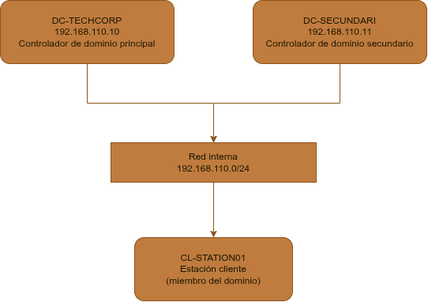

# Despliegue y administración de un dominio Active Directory (TechCorp)

## Escenario

Este proyecto simula la infraestructura de TI de TechCorp, una empresa ficticia que necesitaba centralizar la gestión de identidades, reforzar la seguridad de sus estaciones de trabajo y garantizar la continuidad del servicio ante un fallo del servidor principal. A partir de ese planteamiento, diseñé y desplegué desde cero una infraestructura Active Directory completa: estructura organizativa delegada por departamento, automatización de la gestión de usuarios, políticas de seguridad granulares y un segundo controlador de dominio para alta disponibilidad.

## Arquitectura

| Equipo | Rol | IP |
|---|---|---|
| DC-TECHCORP | Controlador de dominio principal, AD DS, DNS | 192.168.110.10 |
| DC-SECUNDARI | Controlador de dominio secundario (redundancia, roles FSMO distribuidos) | 192.168.110.11 |
| CL-STATION01 | Estación cliente Windows 11, miembro del dominio | 192.168.110.20 (IP estática) |

Red interna: 192.168.110.0/24

## Tecnologías

- Windows Server 2022 (x2, DC-TECHCORP y DC-SECUNDARI)
- Windows 11 (CL-STATION01)
- VirtualBox
- Active Directory Domain Services (AD DS)
- DNS integrado de Active Directory
- Directivas de grupo (GPO): restricciones, preferencias, PSO
- PowerShell (automatización y administración)

## Índice

- [Diseño y despliegue del dominio](#diseño-y-despliegue-del-dominio)
- [Políticas de grupo y seguridad](#políticas-de-grupo-y-seguridad)
- [Alta disponibilidad y recuperación](#alta-disponibilidad-y-recuperación)
- [Recursos](#recursos)

## Diseño y despliegue del dominio

### Preparación del servidor

Antes de instalar el rol de Active Directory, configuré una IP estática en el servidor y le asigné su nombre definitivo (DC-TECHCORP), paso necesario porque un controlador de dominio no puede cambiar de nombre ni de IP una vez promovido sin generar problemas graves de replicación y resolución DNS.

Instalé el rol AD DS (Active Directory Domain Services) y promoví el servidor a controlador de dominio, creando el bosque techcorp.local desde cero.

### Estructura de unidades organizativas (OUs) y delegación

Diseñé una estructura de OUs que refleja la organización departamental de la empresa, separando los departamentos (Sistemes, Desenvolupament, Suport_Tecnic) de los recursos compartidos (grupos de seguridad, carpetas).

Para cada OU departamental, delegué permisos administrativos limitados al grupo de soporte técnico correspondiente, usando dsacls. Esto permite una administración descentralizada sin dar privilegios de administrador de dominio completo.

El listado completo de la estructura de OUs generado por script está disponible en [ou-structure.csv](docs/ou-structure.csv).

### Grupos de seguridad y modelo AGDLP

Apliqué el modelo AGDLP (Account, Global Group, Domain Local Group, Permission), el estándar de Microsoft para gestionar permisos a gran escala: los usuarios se agrupan primero en grupos globales según su función, estos grupos globales se anidan dentro de grupos de dominio local, y es a estos últimos a quienes se asignan finalmente los permisos sobre los recursos.

### Gestión de usuarios

Creé un usuario individual de administración (u_admin_helpdesk) por línea de comandos, y automaticé la alta masiva del resto de la plantilla mediante un script PowerShell que lee los datos desde un CSV.

El script valida si un usuario ya existe antes de crearlo, evitando errores al reejecutarse sobre un dominio ya poblado:

El script y la plantilla CSV están disponibles en [plantillas/](plantillas/), listos para reutilizar en otros despliegues.

### Consultas LDAP

Para validar la calidad de los datos cargados, usé un filtro LDAP combinado que localiza cuentas de usuario activas sin el atributo title relleno, útil para detectar fichas incompletas tras una alta masiva.

## Políticas de grupo y seguridad

### Restricciones de estación de trabajo

Creé una GPO (GPO_Restriccions_Estacions) que restringe el acceso al Panel de Control y bloquea la escritura y lectura en dispositivos de almacenamiento extraíble (USB), aplicada a la OU de departamentos. El equipo de sistemas (GG_Sistemes) queda excluido de esta restricción mediante un permiso explícito de Denegar "Aplicar directiva de grupo", ya que necesita acceso administrativo completo a las estaciones.

Comprobación en el cliente, con un usuario afectado por la restricción:

### Política de contraseñas granular (PSO)

Las políticas de contraseña de un dominio son únicas por defecto (una sola Default Domain Policy para todos). Para exigir una seguridad reforzada solo al personal técnico, creé una Password Settings Object (PSO) aplicada específicamente a GG_Sistemes: contraseñas de 12 caracteres mínimo, historial de 10, caducidad a los 30 días y bloqueo de cuenta tras 3 intentos fallidos.

### Mapeo de unidades de red con Item-Level Targeting

Usando Group Policy Preferences (no Directivas, que no permiten este nivel de filtrado), configuré dos unidades de red: una compartida para toda la organización (S:) y otra exclusiva para el equipo de sistemas (T:), filtrada mediante Item-Level Targeting, un filtro evaluado en el propio cliente, a nivel de elemento individual dentro de la GPO, a diferencia del filtrado de seguridad, que afecta a la GPO completa.

Comprobación en el cliente, comparando el mismo Explorador de archivos con dos usuarios distintos:

### Bloqueo automático de pantalla

Configuré el protector de pantalla para activarse tras 10 minutos de inactividad y exigir contraseña al desbloquear la sesión. Son tres directivas de Windows separadas pero dependientes entre sí (activación, tiempo de espera y protección por contraseña).

### Diagnóstico de políticas aplicadas (RSOP)

Para verificar que el conjunto de políticas se aplica correctamente en el cliente, generé un informe RSOP (Resultant Set of Policy), que muestra todas las GPOs efectivas sobre el usuario y el equipo.

## Alta disponibilidad y recuperación

### Segundo controlador de dominio

Para eliminar el punto único de fallo que supone tener un solo controlador de dominio, promoví un segundo servidor (DC-SECUNDARI) dentro del mismo dominio. Esto proporciona redundancia: si uno de los dos servidores cae, el otro sigue ofreciendo autenticación, DNS y el resto de servicios de directorio sin interrupción.

Comprobé que la replicación entre ambos controladores funciona correctamente, condición indispensable para que el segundo DC sea realmente útil como respaldo.

### Gestión y distribución de roles FSMO

Active Directory delega ciertas operaciones críticas (esquema, nomenclatura de dominio, RID, infraestructura y emulación de PDC) a roles únicos llamados FSMO, que por defecto recaen todos en el primer controlador. Transferí el rol de PDC Emulator a DC-SECUNDARI, distribuyendo así la carga y preparando el dominio para una recuperación más rápida en caso de fallo del servidor principal.

### Papelera de reciclaje de Active Directory

Activé la Papelera de reciclaje de AD, una característica que permite restaurar objetos eliminados (usuarios, grupos, equipos) de forma íntegra, sin necesidad de recurrir a una restauración completa del System State.

Validé su funcionamiento eliminando un usuario de prueba y restaurándolo, comprobando que recupera el mismo objeto (mismo GUID) en lugar de crear uno nuevo.

### Auditoría

Configuré una política de auditoría para registrar eventos críticos de seguridad (creación y modificación de cuentas), generando un rastro verificable en el Visor de sucesos ante cualquier cambio sobre los objetos del dominio.

### Copia de seguridad del System State

Realicé una copia de seguridad del System State del controlador de dominio, que incluye la base de datos de Active Directory (NTDS), el registro y los archivos de arranque del sistema. Es la base de cualquier plan de recuperación ante desastres de un controlador de dominio.

### Procedimiento de recuperación de emergencia (Seize de roles FSMO)

En caso de fallo permanente e irrecuperable del servidor principal, los roles FSMO que tuviera asignados pueden apropiarse (seize) desde el servidor superviviente, a diferencia de una transferencia normal, que requiere que ambos servidores estén operativos. Este procedimiento es la última opción: implica aceptar la pérdida de cualquier cambio no replicado antes de la caída, y exige retirar por completo el servidor fallido de la red una vez recuperado, reinstalándolo desde cero si fuera a reincorporarse, ya que dos titulares del mismo rol FSMO corrompen el directorio.

## Recursos

- [plantillas/](plantillas/): script de alta masiva de usuarios y plantilla CSV, reutilizables en otros despliegues.
- [gpo-backups/](gpo-backups/): copias de seguridad de las GPOs creadas.
- [docs/](docs/): versión del contenido anterior organizada en archivos independientes por bloque.
